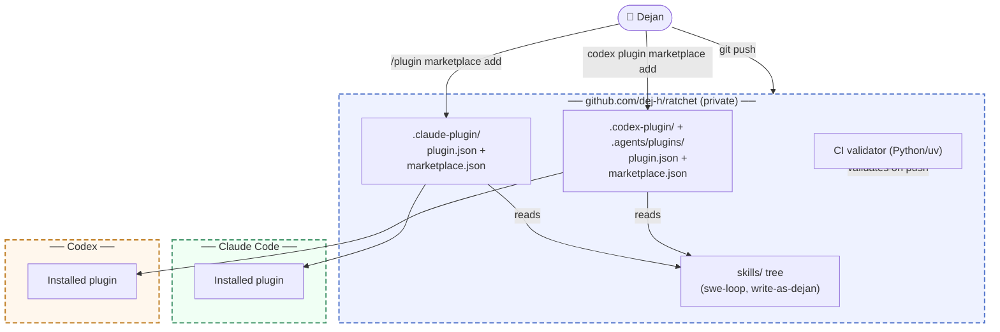

# ADR 001: Single skills tree, dual native manifests, no build step

- **Status:** accepted
- **Date:** 2026-07-19
- **Loop:** bootstrap (`~/.claude/swe-loops/ratchet/bootstrap/`)

## Context

ratchet packages a disciplined SWE workflow (the swe-loop skill) plus a
writing-voice skill (write-as-dejan) as an installable plugin for two coding
agent harnesses: Claude Code and OpenAI Codex. Today the workflow exists only
as local files under `~/.claude/skills/`, unversioned, and Codex reaches it
through an ad hoc read-through of Claude Code's own directories. That breaks
the moment either side changes a path or a format, and it cannot be shared,
versioned, or installed cleanly.

Alternatives were developed and compared in the planning conversation that
preceded this loop, including one full revision after a factual correction
(Codex's plugin/marketplace/skills system, verified 2026-07-19 from
developers.openai.com and the openai/codex source, is materially more capable
than assumed in the first pass). That prior comparison is the basis for this
ADR; it is not re-derived here.

## Options considered

### Option A — Core/adapter split with a build step

A `core/` directory holds harness-neutral prose written against abstract
capabilities. Per-harness `adapters/` carry a thin preamble. A Python build
CLI assembles both into a `dist/` tree per harness at publish time.

- Pros: clean separation if the harnesses ever diverge hard on format.
- Cons: solves a divergence that does not exist. Both harnesses consume the
  identical `SKILL.md` shape under the open agent skills standard
  (agentskills.io, originated by Anthropic, adopted by both Claude Code and
  Codex). A build step adds a failure mode (stale `dist/`, drift between
  `core/` and generated output) for zero present benefit.
- Future-feature fit: adding a third harness would mean one more adapter, but
  the build step's complexity cost is paid on every change, not just when a
  third harness shows up.

### Option B — Duplicate the skill per harness

Maintain two independent copies of the workflow files, one under a
Claude-Code-shaped tree, one under a Codex-shaped tree.

- Pros: zero abstraction, trivially understandable.
- Cons: drift is exactly the failure mode this workflow exists to prevent. A
  Phase 5 anti-pattern fix applied to one copy and forgotten in the other is
  a certainty, not a risk.
- Future-feature fit: every future change must remember to touch two places.
  Rejected outright.

### Option C — Single skills tree, dual native manifests, no build step (chosen)

One `skills/` tree, read identically by both harnesses. Harness-specific
detail (invocation syntax, memory-file target, built-in skill availability)
lives inside the skill itself as a short "Harness notes" section, not as a
separate file. Distribution uses native manifests for each harness
(`.claude-plugin/` for Claude Code, `.codex-plugin/` + `.agents/plugins/` for
Codex) so the repo is simultaneously a plugin and a marketplace for both,
installable with each harness's own commands.

- Pros: nothing to keep in sync because nothing is duplicated; no build
  step, no generated artifacts, no drift surface. Matches the workflow's own
  minimal-diff, no-ceremony-until-proven principle.
- Cons: if a harness's skill format ever forks hard from the shared
  standard, the "Harness notes" section could grow unwieldy. Not true today
  and cheap to revisit if it happens (extract to adapters then, not before).
- Future-feature fit: a third harness adopting the same open standard costs
  one more manifest pair and a few more table rows in the Harness notes
  section, not a new pipeline.

## Decision

Option C. Ship one skills tree, dual native manifests, no build tooling
beyond a small CI validator that checks manifests parse and both harnesses
agree on name and version. This is given up versus Option A: if the two
standards diverge significantly later, splitting `core/` from adapters
becomes a real migration rather than a non-event. Accepted, because that
divergence has not happened and building for it now is speculative
complexity against a documented anti-pattern (ceremony that never fires).

## Acceptance criteria (EARS)

- WHEN a user runs `/plugin marketplace add dej-h/ratchet` in Claude Code
  THE SYSTEM SHALL expose the swe-loop and write-as-dejan skills for
  installation.
- WHEN a user runs `codex plugin marketplace add dej-h/ratchet` in Codex
  THE SYSTEM SHALL expose the same two skills for installation, from the
  same underlying files.
- WHEN either harness loads `skills/swe-loop/SKILL.md`
  THE SYSTEM SHALL find frontmatter (`name`, `description`) and the invariant
  phase content unmodified from the source `~/.claude/skills/swe-loop/`
  files, with only additive harness-specific notes.
- WHEN the CI validator runs against the repo
  THE SYSTEM SHALL fail the build if either manifest is malformed, if the
  two manifests disagree on plugin name or version, or if any SKILL.md is
  missing required frontmatter.
- WHEN a skill file is copied from the source `~/.claude/skills/` tree
  THE SYSTEM SHALL preserve its prose byte-for-byte except for the additive
  Harness notes sections and any Claude-Code-only built-in-skill references
  that require a fallback note for Codex.

## Feature overview

No overall `docs/architecture.md` yet: this loop establishes the
architecture rather than changing an existing one, so this ADR's diagram
doubles as the initial architecture doc. `docs/architecture.md` will be
introduced the first time a later loop changes this picture.

## Consequences

Easier: adding new skills to the marketplace later is "drop a directory
under `skills/`, no pipeline to touch." Harder: if the two harnesses'
skill formats fork significantly, the Harness notes sections will need
splitting out, at which point Option A gets revisited with real cause
instead of speculation. Constrains: future skills in this repo should stay
capability-described rather than assuming Claude-Code-only tool names,
matching the pattern set here.
