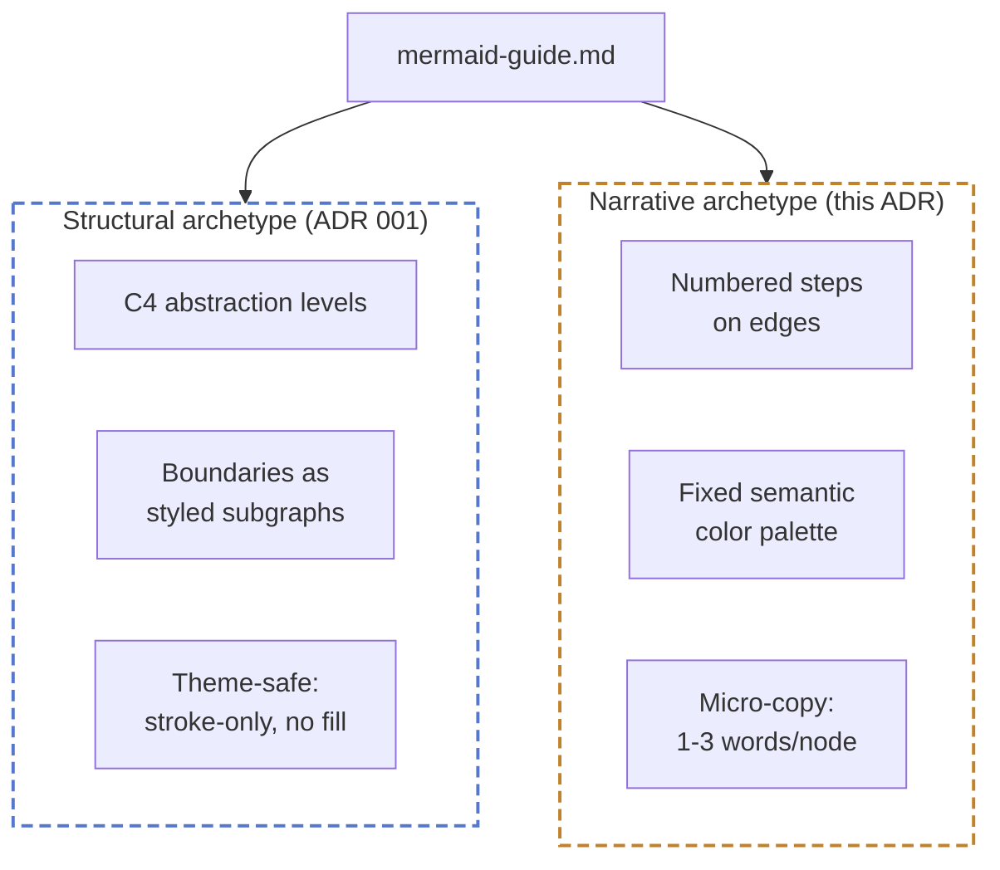

# ADR 002: Narrative diagram techniques (numbered steps, semantic color, micro-copy)

- **Status:** accepted
- **Date:** 2026-07-19
- **Loop:** mermaid-editorial (`~/.claude/swe-loops/ratchet/mermaid-editorial/`)

## Context

mermaid-guide.md (ADR 001) covers one diagram mode well: structural/C4-style
diagrams of a system's components and boundaries. It has no guidance for a
different, common need: a sequential process a reader should follow step by
step (a request's path through a system, a workflow's phases). ByteByteGo's
system-design diagrams, analyzed in the preceding conversation, are the
clearest public example of this mode done well. That analysis (two research
passes plus direct inspection of two of their diagrams) decomposed the style
into named techniques and separated them by cost: roughly 80% is pure
convention (numbered steps, a fixed color-to-meaning mapping, tight
node-label word counts) that mermaid already renders natively on GitHub, and
20% is icon/sticker-fill gloss that requires a render-and-commit pipeline
mermaid-guide.md doesn't have yet.

This PR is the 80%: editorial rules only, zero new tooling, nothing that
touches how a diagram is rendered or shipped. The 20% (icon packs, sticker
fills, committed dual-theme SVGs) is deliberately out of scope here and is
PR 2, stacked on this branch, so its diff is reviewable independent of this
one and can be dropped without losing the editorial rules if the icon
pipeline turns out not to be worth its cost.

Alternatives were developed in the prior conversation (two parallel research
agents comparing ByteByteGo's technique against mermaid's actual capabilities,
plus a direct visual decomposition of two of their diagrams); not re-derived
here.

## Options considered

### Option A — Fold the new rules into the existing structural-diagram section

Add numbered steps, the color palette, and micro-copy as additional bullets
inside the current rule list, without a separate archetype.

- Pros: smallest diff, one section to maintain.
- Cons: the existing rules assume a C4 abstraction level and boundary
  subgraphs; numbered sequential steps answer a different question ("what
  happens, in order") than structure does ("what exists, and how is it
  grouped"). Folding them together produces rules that contradict depending
  on which mode a reader is in (e.g. "one abstraction level per diagram" vs.
  a narrative that legitimately spans request → cache → DNS → TCP as one
  continuous story).
- Future-feature fit: every future narrative-specific rule would need
  re-litigating against the structural rules it sits next to.

### Option B — Distinct "Narrative diagrams" archetype, separate section (chosen)

Add a new section describing when to reach for a narrative diagram instead
of a structural one, with its own rules: numbered edge annotations, the
fixed semantic palette, micro-copy discipline. The existing "right type for
right question" rule (mermaid-guide.md item 9) already establishes that
structure, sequence, lifecycle, and data model each get their own diagram
type; this is that same principle, applied to the case a plain flowchart
covers today but no rule set optimizes for.

- Pros: no contradiction with structural rules; matches the guide's existing
  organizing principle instead of inventing a new one; a reader scans one
  section for "I need to show a process."
- Cons: two sections that both describe styling for something rendered by
  the same `graph`/`flowchart` mermaid syntax, so the guide must be explicit
  about which section governs which. Mitigated by putting the archetype
  choice at the top of the file, ahead of both rule sets.
- Future-feature fit: PR 2's icon/sticker-fill rules attach cleanly under
  this same narrative section, since that is specifically where the
  ByteByteGo look belongs; structural diagrams stay theme-safe and
  icon-free.

### Option C — New standalone document instead of extending mermaid-guide.md

- Pros: zero risk of the two archetypes' rules bleeding into each other.
- Cons: swe-loop's Phase 0 already points at one file
  ([mermaid-guide.md](../../skills/swe-loop/mermaid-guide.md)); a second
  document is one more thing an agent must remember to open, for a
  distinction (structural vs narrative) that fits inside one file's table of
  contents. Rejected: adds a lookup step for no isolation benefit Option B
  doesn't already provide via separate sections.

## Decision

Option B. Given up versus Option A: two sections to keep mutually consistent
as the guide grows. Accepted, because the two modes answer genuinely
different questions and the guide already organizes around that principle
elsewhere.

## Acceptance criteria (EARS)

- WHEN an agent needs to communicate a sequential, multi-step process
  THE SYSTEM SHALL offer a "narrative diagram" archetype in mermaid-guide.md,
  distinct from the structural/C4 archetype.
- WHEN a narrative diagram is produced THE SYSTEM SHALL number each step on
  its edge label using a documented convention (circled-digit prefixes).
- WHEN a narrative diagram uses color THE SYSTEM SHALL draw only from a
  fixed, documented palette where each hue carries exactly one meaning for
  the whole diagram (e.g. green never means both "success" and "data" in the
  same canvas).
- WHEN any node label is written in a narrative diagram THE SYSTEM SHALL
  keep it to 1-3 words, with explanatory sentences placed in surrounding
  prose instead of the diagram.
- WHEN a narrative diagram is produced THE SYSTEM SHALL pass the existing
  render-QA loop (dark and light renders, inspected against the checklist)
  before shipping, exactly as structural diagrams already must.
- WHEN this PR ships THE SYSTEM SHALL NOT introduce icon packs, sticker
  fills, or any committed-image rendering workflow — that is PR 2's scope
  entirely, stacked on this branch.

## Feature overview

`docs/architecture.md` does not exist and is not introduced here: this
changes documentation content, not the shipped system's architecture.

## Consequences

Easier: agents get an explicit answer for "how do I show a process clearly"
instead of defaulting to a plain flowchart with no color or ordering
discipline. Harder: two archetypes to keep mutually legible as the guide
grows; mitigated by the archetype choice living at the top of the file.
Constrains: PR 2 (icons, sticker fills, committed SVGs) must attach under
the narrative section specifically — structural diagrams stay GitHub-native
and theme-safe, per ADR 001's already-learned lesson about fills.
