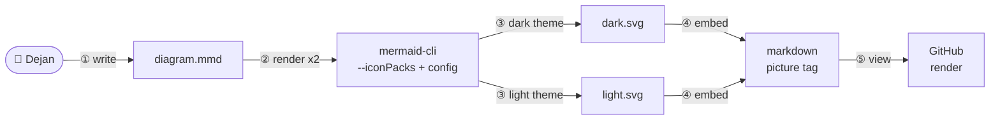

# ADR 003: Icon and sticker-fill rendering track (render-and-commit)

- **Status:** accepted
- **Date:** 2026-07-20
- **Loop:** mermaid-icons (`~/.claude/swe-loops/ratchet/mermaid-icons/`)

## Context

ADR 002 shipped the editorial 80% of ByteByteGo's diagram style: numbered
steps, a fixed semantic palette, micro-copy discipline, all native GitHub
mermaid. The remaining 20%, real icons and pastel sticker fills, needs
tooling GitHub's inline renderer doesn't have: GitHub registers no iconify
packs, so icon shapes render as unresolved placeholder boxes there. This PR
stacks on ADR 002's branch and adds that remaining piece as a
render-and-commit track: pre-render with mermaid-cli locally (where icon
packs and full theming work), commit the resulting images, embed them.

Alternatives were compared in the prior conversation's research (D2,
mermaid+render-and-commit, mingrammer). This ADR selects among them and adds
verification the conversation research could not do: actually running the
chosen toolchain.

## Options considered

### Option A: D2 (d2lang.com)

A second diagram language with first-class icon support and a
purpose-built architecture layout engine (TALA, proprietary; ELK free at
~90% of TALA's quality).

- Pros: closest match to the ByteByteGo look; purpose-built layout for this
  specific job.
- Cons: a second language alongside mermaid, which ADR 001 deliberately
  avoided introducing without proven need (Option C in that ADR: duplication
  is the disease this workflow exists to prevent, and two diagram languages
  is a milder version of the same problem). No GitHub-native rendering either
  way, so D2's main advantage
  over mermaid+icons is layout quality, not capability we're missing.
- Future-feature fit: adopting D2 later, if native mermaid's icon track
  proves insufficient, remains possible. Nothing here forecloses it.

### Option B: mermaid + render-and-commit (chosen)

Keep mermaid as the only diagram language (per ADR 001's existing
commitment); for diagrams that warrant the icon/sticker treatment,
pre-render locally with mermaid-cli's `--iconPacks` flag and commit the
result.

- Pros: zero new language and reuse of the render-QA pipeline ADR 001 already
  established (mermaid-cli is already used by that workflow). Empirical checks
  in this loop verified the icon and theming
  features actually work: `--iconPacks @iconify-json/mdi` turns unresolved
  "?" placeholders into real icons (reproduced, see Phase 3), and a targeted
  `themeVariables.titleColor` config override fixes subgraph-title
  legibility on sticker-filled containers in dark mode without disturbing
  anything else (also reproduced).
- Cons: two rendering paths now exist (inline GitHub-native for structural/
  most narrative diagrams, render-and-commit for icon-track diagrams). A
  reader must know which a given diagram is. Mitigated by the icon track
  living under its own clearly-labeled subsection with its own worked
  example, same pattern ADR 002 used to separate narrative from structural.
- Future-feature fit: this is additive to ADR 002, not a replacement. Most
  diagrams stay simple/native; the icon track is reached for deliberately,
  same as narrative vs structural.

### Option C: mingrammer `diagrams` (Python, cloud-provider icon sets)

- Pros: official AWS/Azure/GCP/K8s icons, Python source, and multiple output
  formats including SVG and PDF
  (https://diagrams.mingrammer.com/docs/guides/diagram).
- Cons: its Graphviz and provider-oriented model targets cloud topology. A
  coordinated light/dark pair still needs custom graph and node attributes,
  and the catalog does not cover the general workflow concepts used here.
  Rejected because Option B covers the current diagrams without a second
  source language.

## Decision

Option B. Given up versus Option A: layout quality (mermaid's dagre-based
default is adequate but not TALA-grade) and a smaller curated architecture
icon set. Accepted because it keeps one source language and the technical
claims about the chosen path were verified by running the render. Real icons
load, theme-specific SVGs render, and the sticker title and contained icons
remain legible after targeted dark-theme and source-level styling.

## Acceptance criteria (EARS)

- WHEN an icon-track diagram is rendered without `--iconPacks`
  THE SYSTEM SHALL show unresolved placeholder icons, documented as the
  reason the flag is mandatory, not assumed.
- WHEN an icon-track diagram is rendered with `--iconPacks @iconify-json/<set>`
  THE SYSTEM SHALL render the real icons from that set, verified by
  reproduction in both dark and light themes.
- WHEN a sticker-fill container (pastel fill, thick dark stroke) is used in
  the dark-theme render THE SYSTEM SHALL keep the container's title text
  legible via an explicit `themeVariables.titleColor` config override,
  verified by reproduction. The same failure mode ADR 001 found for
  native subgraphs recurs here and gets the analogous fix.
- WHEN icons are placed inside a light sticker-fill container in the dark
  render THE SYSTEM SHALL give them a filled form that keeps the glyphs
  visibly distinct from the container background.
- WHEN icon-track artifacts are committed THE SYSTEM SHALL include the
  `.mmd` source, both theme renders, the shared config used, and the renderer
  version from the verification record so the artifact has enough provenance
  to be re-rendered. Floating upstream packages mean byte-identical future
  output is not promised.
- WHEN an existing native diagram is rendered after this change THE SYSTEM
  SHALL require no icon-pack flag or committed image artifact, and its source
  SHALL remain unchanged.

## Feature overview

`docs/architecture.md` is not introduced: this is a documentation-tooling
decision, not a change to the shipped system's architecture.

## Consequences

Easier: diagrams meant to be social or teaching objects (README hero images,
flagship ADRs) can now use real icons and sticker fills with source and render
provenance instead of one-off image edits. Harder: every icon-track diagram
ships three committed files (source + two renders), plus one shared config for
sticker fills. Regenerating on change is a manual step. No CI wiring exists
yet; the gap is stated below. Constrains: icon-track diagrams must still
follow the shared rules (numbered steps, micro-copy, node-count ceiling) from
ADR 002. This ADR adds rendering capability, not a license to abandon the
editorial discipline.

## Known gap (stated, not hidden)

No CI check regenerates or verifies icon-track SVGs stay in sync with their
`.mmd` source. `tools/validate.py` checks manifests/frontmatter/ADR
presence only. A committed SVG could silently drift from its source if
someone edits one without the other. Left unaddressed in this PR
deliberately. It is the kind of machinery-on-probation the loop's
own control-group principle warns against building before it is needed;
revisit if drift actually happens in practice, not preemptively.
