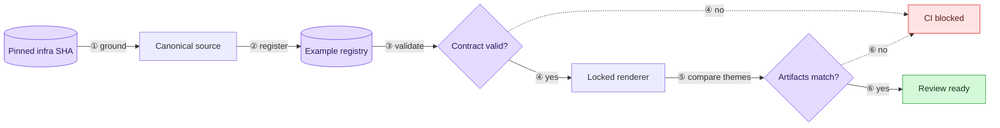

# ADR 004: Canonical Mermaid examples and enforceable render contract

- **Status:** accepted
- **Date:** 2026-07-20
- **Loop:** mermaid-icons (`~/.claude/swe-loops/ratchet/mermaid-icons/`)
- **Amends:** ADR 003

## Context

ADR 002 defines a five-color semantic palette for narrative diagrams. ADR 003
adds an icon rendering track. Both pieces work technically, but the current
examples do not prove the combination to a reader: the architecture example
does not assign semantic classes, the swe-loop example uses only two classes,
and the icon example uses none. That is why the colors are hard to see in the
GitHub Markdown and the committed SVGs even though Mermaid renders the
`classDef` values correctly.

The second icon diagram also crosses ADR 003's recorded trigger for a locked
renderer and source-to-SVG check. Continuing with floating `npx` and unpkg
resolution would make a larger example corpus less trustworthy, not more.
The canonical examples therefore need to teach the editorial rules and prove
the generated artifacts are current.

The examples will describe behavior from the committed infrastructure
`origin/main` snapshot at `99baa4b2af97285cc50b3afaef4abe9bbd2ae12c`. The infrastructure
checkout contains unrelated uncommitted work, so working-tree content is not
accepted as evidence. The two direct examples are:

1. The automated full-stack PR review path, grounded in
   `.github/workflows/review-listener.yml`, `relay/function_app.py`,
   `relay/_classify.py`, and
   `control-plane/src/control_plane/review/post_review_result.py`.
2. The fail-before-update full-stack deployment path, grounded in
   `.github/workflows/deploy-listener-fullstack.yml`,
   `.github/workflows/_reusable-fullstack-build.yml`, and
   `relay/_classify.py`.

The review example stays GitHub-native so the guide directly demonstrates
that the palette renders inside Markdown. The deployment example uses the
icon track and commits dark and light SVGs. Together with the existing cache
fixture, this covers both rendering modes without turning every diagram into
generated artwork.

## Options considered

### Option A: Instructions and examples only

Add the examples to the guide, add diagram evidence fields to the loop state,
and keep render QA manual.

- Pros: smallest change and no new toolchain.
- Cons: the current guide already contains edges that violate its own
  mandatory numbering rule, while CI remains green. More prose would make the
  intended behavior clearer without making it enforceable.

### Option B: Registry plus structural validation

Register the canonical examples and extend the existing Python validator with
a deliberately narrow contract: exact palette values, numbered and labeled
edges, node limits, icon labels, icon-pack declarations, and artifact
provenance.

- Pros: deterministic, fast, and compatible with the current stdlib-only
  validator.
- Cons: hashes and SVG label projection can detect likely drift but cannot
  prove that an SVG was generated from its current source. It would leave ADR
  003's source-to-render gap open after the recorded trigger has fired.

### Option C: Registry, structural validation, and locked rendering (chosen)

Use Option B for the canonical editorial contract. Add an isolated Node
toolchain for actual rendering, resolved through npm and committed with its
lockfile. The renderer reads icon data from the locked local Iconify packages,
serves it on loopback for mermaid-cli's named icon-pack URL interface, and
never resolves icon bytes from unpkg. Stable Mermaid ID and hand-drawn seeds,
plus first-seen normalization of Iconify's generated internal definition IDs,
make repeated renders deterministic without changing icon geometry. The check
command renders into a temporary directory and byte-compares icon-track output
with the committed dark and light SVGs.

- Pros: proves both the source-level rules and the generated-artifact
  contract. It addresses the exact known gap in ADR 003 at the trigger ADR
  003 recorded.
- Cons: CI gains Node, Chromium, and npm installation cost. Exact output is
  authoritative for the pinned Linux CI environment, so dependency, browser,
  or rendering-environment upgrades must regenerate and review the artifacts.

## Decision

Choose Option C, scoped to registered canonical examples rather than all
Mermaid in the repository.

The registry is the boundary. The Python validator may parse its restricted
canonical sources, but it must not claim to be a general Mermaid parser. It
checks mechanically observable rules only. The renderer owns source-to-SVG
derivation and uses the lockfile plus local icon data. Visual hierarchy,
contrast, routing, and whether the diagram tells the truth remain review
responsibilities because neither regexes nor a successful render can prove
those properties.

The initial registry contains the guide's two existing native examples, its
existing icon fixture, and the two new infrastructure narratives. Native
guide fences must match their registered `.mmd` sources. Icon entries must
match their committed theme artifacts. This makes "canonical" a concrete
repository contract instead of a heading with no enforcement boundary.

The loop itself is tightened in two places. Phase 0 records a diagram plan
and dark/light inspection evidence before Gate A. Phase 6 repeats rendering,
inspection, and the canonical check whenever diagram source changed after
approval. The external state file remains the source of truth for human gate
approval; CI cannot honestly infer a conversation happened.

## Acceptance criteria (EARS)

- WHEN the canonical corpus is shipped THE SYSTEM SHALL include an
  infrastructure review example in GitHub-native Mermaid and an
  infrastructure full-stack deployment example in icon rendering mode.
- WHEN an infrastructure example is registered THE SYSTEM SHALL record the
  immutable infrastructure revision and the repository-relative source paths
  that ground its claims.
- WHEN either infrastructure narrative is read THE SYSTEM SHALL use all five
  semantic classes only for their defined meanings: completed, transport,
  protocol, blocked, and decision.
- WHEN a registered narrative source is validated THE SYSTEM SHALL require
  every edge to have a non-empty label beginning with a circled step number,
  a contiguous step sequence beginning at ①, no more than twelve connected
  nodes, and the exact five palette definitions from ADR 002.
- WHEN a registered GitHub-native example is validated THE SYSTEM SHALL reject
  icon syntax and SHALL confirm that the guide's rendered Mermaid fence is
  identical to the registered source.
- WHEN a registered icon example is validated THE SYSTEM SHALL require a text
  label for every icon, exactly the locked Iconify packages matching the
  prefixes used, and both committed theme renders.
- WHEN the renderer loads icon packs THE SYSTEM SHALL read the icon data from
  resolver-locked local packages through a loopback-only endpoint and SHALL
  make no unpinned unpkg request.
- WHEN a registered icon source, render config, renderer, dependency lock, or
  icon pack changes THE SYSTEM SHALL reproduce deterministic dark and light
  SVGs and SHALL fail the check if either committed artifact differs.
- WHEN a design diagram exists before Gate A THE LOOP SHALL record its
  purpose, archetype, rendering mode, source, and completed dark and light
  visual inspections in `state.md`.
- WHEN diagram source changes after Gate A THE LOOP SHALL repeat both theme
  renders, visual inspection, and the canonical check during Phase 6.
- WHEN the existing swe-loop narrative example is retained THE SYSTEM SHALL
  give its approval and amendment edges circled, non-empty step labels so the
  example follows the rule it teaches.
- WHEN a non-canonical GitHub-native diagram needs no icons THE SYSTEM SHALL
  continue to require no Node dependency and no committed render artifacts.

## Feature overview

This is documentation tooling and loop enforcement, not a change to the
ratchet plugin's runtime architecture. It does not introduce or update
`docs/architecture.md`.

## Consequences

Easier: readers get two truthful infrastructure examples that visibly use
the full semantic palette, one rendered directly by GitHub and one through
the icon track. Reviewers can distinguish an editorial rule failure from a
stale generated artifact, and CI catches both classes of mechanical drift.

Harder: the repository owns a small isolated Node toolchain and its generated
SVG contract. Toolchain upgrades require intentional regeneration and visual
review. The structural validator must stay deliberately narrow so canonical
examples do not become an excuse to build a partial Mermaid implementation.

Still manual: a human must judge semantic truth, abstraction level,
micro-copy, crossings, clipping, contrast, and whether the result is actually
useful. The loop records those checks instead of pretending CI can automate
them.
