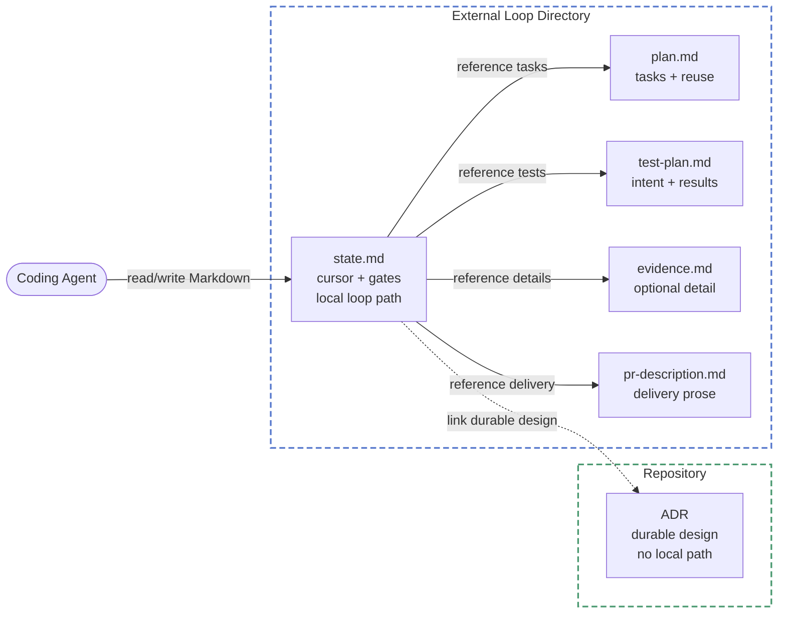

# ADR 005: Compact loop records and durable ADR metadata

- **Status:** accepted
- **Date:** 2026-07-24

## Context

`state.md` is the durable resume point for an SWE loop, but its current
template also owns diagram inspections, reuse inventories, decision history,
review findings, and zoom-out notes. In the XRFlowPilot loop that file reached
149 lines, while the state, plan, test plan, and PR description together
reached about 566 lines. Resuming the loop repeatedly reloads completed detail
that already belongs to another artifact. Phase 4 adds a separate cost by
requiring test planning in a different conversation turn from implementation,
even though the enforceable boundary is persistence order: test intent must
exist before test code changes.

The committed ADR template has a related ownership error: its `Loop` metadata
points at author-local working state. That path is inaccessible to repository
readers and becomes dead once the local loop directory is removed. The loop
path is execution state, not durable decision context.

## Options considered

### Option A: Keep the current template and add compaction guidance

Retain every existing section in `state.md`, then tell the agent to shorten
completed entries at phase transitions.

- Pros: smallest documentation change and no new artifact ownership rules.
- Cons: the template still invites copied evidence and gives no bounded
  definition of a valid execution cursor. The Phase 4 ordering remains prose
  with no distinct persisted boundary.
- Future-feature fit: each new workflow check is likely to add another state
  section, recreating the same resumption cost.

### Option B: Bounded cursor with explicit artifact ownership (chosen)

Limit `state.md` to loop identity, current phase and task, task status, exact
gate authority, test-intent status, last reviewed SHA, active findings and
waivers, and durable evidence references. The ADR owns design decisions,
`plan.md` owns task detail and reuse inventory, `test-plan.md` owns planned
tests and their results, and the PR or `pr-description.md` owns delivery prose. Detailed
diagram, review, or verification records without a natural owner can live in
an optional `evidence.md`.

At each phase transition, replace cursor values in place and reduce completed
detail to one result plus a durable reference. On resume, read `state.md`
first, then load only the artifacts referenced by the active phase, task, or
exception.

Phase 4 becomes one ordered transition:

1. Write a materially complete `test-plan.md`.
2. Record the persisted test-intent boundary and test-plan path in `state.md`.
3. Edit test code, continuing in the same conversation turn when useful.

The bugfix profile keeps red-before-green by moving this boundary and the
failing reproduction ahead of the production fix.

Committed ADR metadata contains only durable repository information. The
external loop path remains in `state.md` and is forbidden from the ADR
template and Phase 0 output.

- Pros: makes resumption bounded without weakening either human gate,
  independent review, or verification. The stored ordering is inspectable
  after context loss.
- Cons: evidence links can become stale, and reviewers must follow a reference
  when they need completed detail.
- Future-feature fit: new evidence belongs to a named owner instead of adding
  another diary section to `state.md`.

### Option C: Machine-readable state and workflow directives

Replace or supplement the Markdown cursor with YAML or JSON and encode phase
ordering through machine-readable directives.

- Pros: stronger schema validation and easier automation.
- Cons: introduces a second representation or makes the primary review
  surface less readable. It also turns a focused workflow correction into a
  state engine without a current consumer for that machinery.
- Future-feature fit: useful if Ratchet later gains a runtime that executes
  state transitions. That runtime does not exist today.

## Decision

Choose Option B. `state.md` remains Markdown and remains the sole durable
authority for the execution cursor and both human gates. It is not an
append-only history.

The state template will expose bounded sections for cursor fields, gate
authority, phase status, task status, active exceptions, and evidence
references. Gate status lives only in separate Gate A and Gate B authority
blocks, whose fenced wording can preserve multiline messages and Markdown
table delimiters. Test-intent persistence lives only in the cursor, while
phase execution lives only in the phase table. Exact gate wording and waivers
are never compacted. Resolved findings move to their owning evidence.

Any remediation after a review pass invalidates every pass over the earlier
revision. Phase 5 must converge on the unchanged revision delivered at Gate B.
Branch mode identifies that revision by its HEAD SHA. Workspace mode records
both the base SHA and a SHA-256 fingerprint of the binary diff.

Validation will enforce structural state sections, fields, and tables; the
absence of known diary sections; the ordered Phase 4 protocol labels; and
durable-only ADR template metadata. It deliberately will not lint general
instruction prose or pretend static checks can prove that an agent followed
the instructions.

## Acceptance criteria (EARS)

- WHEN a loop is initialized THE LOOP SHALL record its profile, mode,
  repository, branch, status, current phase, current task, task statuses,
  test-intent status, last reviewed SHA, gate authority, active exceptions,
  and evidence references in `state.md`.
- WHEN a phase transition completes THE LOOP SHALL update cursor values in
  place and reduce completed detail to a result plus a durable evidence
  reference.
- WHEN a human approves Gate A or Gate B THE LOOP SHALL preserve the date and
  exact user wording in a dedicated multiline-safe block in `state.md` and
  SHALL NOT infer approval from CI, PR, commit, checkbox, or artifact state.
- WHEN an existing loop resumes THE LOOP SHALL read `state.md` first and then
  load only artifacts referenced by the active phase, task, or exception.
- WHEN test intent is incomplete or only an empty template exists THE LOOP
  SHALL NOT mark the test-intent boundary complete.
- WHEN test intent is materially complete THE LOOP SHALL persist
  `test-plan.md` and record its path and completed boundary in `state.md`
  before editing test code.
- WHEN the persisted test-intent boundary is recorded THE LOOP MAY continue
  test implementation in the same conversation turn without another human
  checkpoint.
- WHEN the active profile is `bugfix` THE LOOP SHALL record a failing
  reproduction before the production fix and passing evidence after it.
- WHEN source or test code changes after independent review THE LOOP SHALL
  mark the last reviewed SHA stale and repeat every Phase 5 pass against the
  new revision.
- WHEN Phase 5 completes THE LOOP SHALL identify the exact reviewed revision
  and SHALL NOT deliver a different revision at Gate B.
- WHEN findings remain unresolved or are waived THE LOOP SHALL retain their
  concise status and evidence reference through Gate B.
- WHEN a new ADR is created THE LOOP SHALL keep the external loop path only in
  `state.md` and SHALL NOT add a `Loop` field or author-local path to committed
  ADR metadata.
- WHEN the repository validator runs THE SYSTEM SHALL reject a state template
  missing or duplicating required cursor or gate fields, incomplete status
  tables, or an authority section other than exactly Gate A and Gate B.
- WHEN the repository validator runs THE SYSTEM SHALL reject an ordered Phase
  4 protocol that does not place planning, persistence, and boundary recording
  before test editing.
- WHEN the repository validator runs THE SYSTEM SHALL reject an ADR template
  containing a `Loop` field or author-local loop path.

## Feature overview

The distribution and runtime boundaries from ADR 001 do not change. This
decision changes ownership and loading rules for external loop records, so it
does not introduce `docs/architecture.md`.

## Consequences

Resumption starts with a bounded cursor instead of accumulated history.
Phase 4 can continue autonomously once its inspectable ordering boundary is
persisted. The two human gates and independent review remain unchanged.

The workflow gains one optional evidence artifact and stronger ownership
rules. New ADRs lose a metadata field that had no durable reader value.
Broken references remain possible, so Phase 6 must verify referenced evidence
exists. Static validation can protect the shipped contract, but dogfood
scenarios remain necessary to prove actual read and write order.
