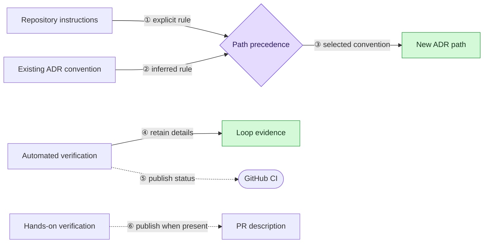

# ADR 006: Keep repository artifacts aligned with their owners

- **Status:** proposed
- **Date:** 2026-08-12
- **Issues:** [#5](https://github.com/dej-h/ratchet/issues/5), [#12](https://github.com/dej-h/ratchet/issues/12)

## Context

The SWE loop currently imposes two defaults that belong to other systems. It
always names new ADRs `NNN-<slug>.md`, even when the target repository uses
descriptive filenames, and it copies local automated commands and pass counts
into pull request descriptions, even though CI already reports those results.
Both behaviors create drift: the first introduces a repository convention that
was never chosen, while the second publishes a verification snapshot that can
be stale after the next push. Ratchet needs to preserve its local evidence
without treating that evidence as repository-owned documentation.

## Options considered

### Option A: Change the examples only

Replace the numbered ADR example and the `What was tested` section without
adding explicit resolution or ownership rules.

- Pros: smallest documentation diff.
- Cons: leaves ambiguous how an agent chooses an ADR path, where automated
  verification remains visible, and when a manual testing section is omitted.
- Future-feature fit: every new artifact type would need another isolated prose
  correction because there is no shared ownership rule.

### Option B: Define artifact ownership and validate the contract (chosen)

Resolve ADR paths from explicit instructions and existing repository
conventions before using a descriptive fallback. Keep automated verification
in loop evidence and the Gate B handoff, rely on CI for published automated
status, and include `Manual testing` in a PR description only when hands-on
verification occurred. Extend the structural validator so these rules cannot
silently regress.

- Pros: addresses both failures at their source and keeps the rules executable
  without adding runtime tooling.
- Cons: the validator must inspect a small amount of Markdown contract text.
- Future-feature fit: later repository-facing artifacts can follow the same
  rule: discover the repository convention first and publish only evidence
  owned by that surface.

### Option C: Generate ADR paths and pull request bodies with a new CLI

Add a command that inspects the repository, selects the ADR filename, and
renders the final pull request body from structured loop evidence.

- Pros: centralizes both decisions in code.
- Cons: adds a runtime interface and parser for behavior that is currently
  executed by the skill. The requested rules do not justify that maintenance
  surface.
- Future-feature fit: useful only if Ratchet later moves from an instruction
  contract to an executable workflow engine.

## Decision

Choose Option B.

New ADR paths use this precedence order:

1. Follow an explicit repository instruction or user choice.
2. Reuse the repository's existing ADR directory and filename convention.
3. When no convention exists, use
   `docs/architecture-decisions/<descriptive-slug>.md` without introducing a
   sequence number.

Numbered filenames remain correct in repositories that already use them.
Existing ADRs are never renamed as part of this resolution.

Automated commands, pass counts, and detailed results remain in `state.md`,
`test-plan.md`, or referenced loop evidence and are included in the Gate B
chat handoff. They are not copied into the generated pull request description.
CI remains the published source for automated check status. A pull request body
contains a `Manual testing` section only when hands-on checks produced evidence
that CI does not expose, such as a browser flow, provider-backed request,
device check, or live-environment verification.

The existing structural validator will enforce the stable parts of this
contract. It will not select filenames or generate pull request prose.

## Acceptance criteria (EARS)

- WHEN a target repository defines an ADR location or filename convention THE
  LOOP SHALL use that convention for a new ADR.
- WHEN a repository already numbers ADR filenames THE LOOP SHALL preserve the
  numbered convention.
- WHEN no ADR filename convention exists THE LOOP SHALL create a descriptive
  `<slug>.md` filename without introducing a sequence number.
- WHEN an explicit repository instruction or user choice conflicts with an
  inferred ADR convention THE LOOP SHALL follow the explicit direction.
- WHEN the loop generates a pull request description THE LOOP SHALL exclude
  local automated commands, pass counts, and other CI-owned verification
  details.
- WHEN hands-on verification produced reviewer-relevant evidence THE LOOP
  SHALL include it under `Manual testing` in the pull request description.
- WHEN no hands-on verification was performed THE LOOP SHALL omit the
  `Manual testing` section.
- WHEN Gate B is presented THE LOOP SHALL retain local automated verification
  in loop evidence and summarize its current result in the chat handoff.
- WHEN the structural validator runs THE SYSTEM SHALL reject workflow or
  template changes that restore the imposed numbered fallback or automated
  PR-test reporting.

## Feature overview

## Consequences

Repository conventions remain deliberate instead of being introduced by the
workflow. Pull request descriptions stay current because they no longer copy
the CI-owned automated status, while local verification remains available at
Gate B and in the loop evidence. The templates and validator gain a few
explicit contract checks, but Ratchet does not gain a generator or another
runtime dependency.
