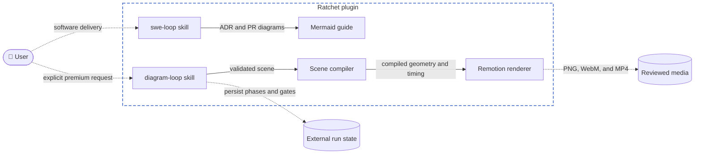

# ADR 007: Diagram loop as an isolated sibling skill

- **Status:** accepted
- **Date:** 2026-09-03

## Context

Ratchet's Mermaid path is designed for repository-safe ADR, architecture, and
PR comprehension. It does not own art direction, authentic visual assets,
pixel review, animation, or publication formats. Those requirements need a
separate workflow with durable external state and the same two explicit human
gates, without importing the software-delivery lifecycle or making premium
rendering an automatic part of `swe-loop`.

## Options considered

### Option A: Extend the existing Mermaid renderer

- How it works: add scene compilation, Remotion composition, and media export
  to `tools/diagrams`, then expose it through a new skill.
- Pros: one Node version, browser policy, font catalog, and dependency lock.
- Cons: premium animation and canonical Mermaid validation acquire a shared
  release boundary. External run paths would also pressure the Mermaid
  renderer's repository-path containment contract.
- Future-feature fit: every new visual primitive increases a tool that still
  has to remain safe and deterministic for ordinary ADR diagrams.

### Option B: Ship an isolated renderer inside `diagram-loop` (chosen)

- How it works: keep phase and gate instructions in a small sibling skill.
  Put a strict scene compiler, layout strategies, geometry checks, Remotion
  composition, and export commands in one private package below that skill.
- Pros: the installed skill contains its full capability, Mermaid stays
  unchanged, and scene compilation can be tested without Chromium or media
  export. The renderer can adopt proven font, icon, containment, and
  deterministic-output patterns without importing the current Mermaid code.
- Cons: Ratchet owns a second dependency lock and browser installation path.
  Font and icon upgrades must be reviewed in both toolchains when both use the
  same upstream assets.
- Future-feature fit: a separately designed capture adapter could enter through
  the compiled-scene boundary later without changing the five core compilers.

### Option C: Split the renderer into npm workspaces

- How it works: create separate core, Remotion, and CLI packages under the
  skill with a private workspace root.
- Pros: dependency and replacement boundaries are mechanically explicit.
- Cons: package plumbing increases before Ratchet has a second renderer
  backend or consumer. Directory and module boundaries provide the required
  separation with less installation and review overhead.
- Future-feature fit: the modules can be promoted to workspaces if a second
  backend or independent consumer proves the need.

## Decision

Choose Option B. `diagram-loop` is a sibling of `swe-loop` and owns a private,
single-package renderer. `SKILL.md` owns the eight phases, exact gate wording,
resume behavior, and external run artifacts. The renderer owns validated scene
data, deterministic geometry and timing, input digests, media export, and
mechanical review evidence. Renderer commands never infer or originate gate
approval. `record-gate` only stores the exact human wording from the active
conversation.

The compiler emits a versioned `compiled-scene.json`; Remotion only converts
that compiled scene and a frame number into pixels. Layout is selected by
archetype: ELK layered layout for architecture, ordinary flow, and feedback;
deterministic stage, sequence, and concurrency layouts for the other core
archetypes. Product-demo capture is deferred and is not advertised by this
release.

The reviewed-input digest covers normalized scene and asset data, selected
asset bytes, bundled fonts and icons, design tokens, export settings, renderer
source identity, and the dependency lock. Review also records exact output
checksums. Any input or output mismatch invalidates review before Gate B.

Remotion remains behind the rendering boundary because its license is not
MIT. Current free eligibility covers individuals, nonprofits, and for-profit
organizations with at most three employees. Distribution or commercial use
outside that group requires a company license. Eligibility must be confirmed
before this dependency is merged or used commercially.

## Acceptance criteria (EARS)

- WHEN `diagram-loop` is installed THE SYSTEM SHALL expose it as a sibling
  skill without changing the existing Mermaid rendering behavior.
- WHEN a user explicitly requests a premium or animated diagram THE LOOP SHALL
  create or resume fixed-shape state below the correct external diagram-loop
  run root.
- WHEN a run resumes THE LOOP SHALL continue from its first incomplete
  boundary without re-asking an approved gate.
- WHEN gate approval is absent THE LOOP SHALL NOT infer it from files,
  renders, checkboxes, prior runs, or automated checks.
- WHEN a reviewed scene, asset, font, icon lock, renderer input, token, or
  export setting changes THE SYSTEM SHALL invalidate the reviewed digest.
- WHEN a supported scene compiles THE SYSTEM SHALL measure text with bundled
  fonts before layout and reject safe-area, overlap, route-clearance,
  endpoint-ownership, label-collision, or viewport violations.
- WHEN architecture, flow, feedback, sequence, or concurrency input is
  supplied THE SYSTEM SHALL dispatch it to its declared deterministic layout
  strategy and emit one versioned compiled-scene contract.
- WHEN a trace renders THE SYSTEM SHALL keep its quiet scaffold arrowless and
  reveal a separate arrowhead only near trace completion after the destination
  is visible.
- WHEN a silent explainer is timed THE SYSTEM SHALL give each caption at least
  4.8 seconds and hold the complete final overview for five seconds.
- WHEN local assets are resolved THE SYSTEM SHALL require provenance, license,
  and content hashes, and SHALL reject missing, unresolved, or fabricated
  consequential assets.
- WHEN narrative review frames are selected THE SYSTEM SHALL include the
  before, active, and settled boundaries for every action that can introduce
  clipping, overlap, premature arrows, or camera defects.
- WHEN final media is exported THE SYSTEM SHALL produce a final PNG and, for
  animated scenes, WebM and MP4 from the same reviewed compiled scene.
- WHEN website integration guidance is produced THE LOOP SHALL preserve the
  final poster for reduced motion and play the muted inline video once when it
  becomes substantially visible.

## Feature overview

This adds a second shipped skill and renderer boundary. The same structural
view is maintained in `docs/architecture.md`.

## Consequences

Premium diagram work gets explicit art direction, authentic assets,
deterministic compilation, pixel review, and media outputs without raising the
cost of ordinary repository diagrams. Scene and asset changes remain the main
revision surface; layout and renderer code change only for reusable defects.

The plugin becomes larger and gains a second locked Node toolchain. Media
smoke tests cost more than compiler tests, and Remotion use carries a license
check that Ratchet's MIT license cannot replace. Product-demo capture remains
outside this release and needs its own design before the skill can advertise it.
