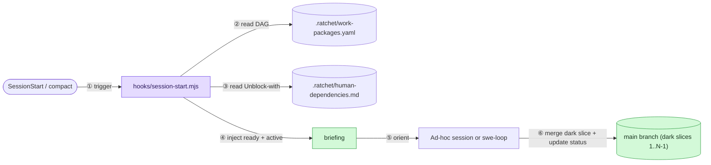

# ADR 008: Always-on `.ratchet/` work-package DAG and dark-launch ledger

- **Status:** accepted
- **Date:** 2026-10-30
- **Issues:** [#22](https://github.com/dej-h/ratchet/issues/22)

## Context

`swe-loop` is an explicit, opt-in autonomous delivery mode (`#16`), and its
`~/.claude/swe-loops/<repo>/<slug>/state.md` cursor only tracks a single loop
run on one machine. When a developer works part-time or ad-hoc across multiple
sessions, concurrent initiatives, and external blockers (such as CISO
approvals, IT tickets, or `main`-only OIDC deployment runbooks), there is no
repository-committed state recording which slices are already merged on `main`,
which slices are dark-launched awaiting a live runbook check, and which slices
are waiting on external human dependencies.

Without that shared cursor on `main`, developers keep entire multi-thousand-line
features inside long-lived unmerged pull requests as a mental container so they
do not lose track of half-merged work or break users between sessions.

## Options considered

### Option A: Make `swe-loop` always-on and commit `state.md` into the repo

- How it works: activate `swe-loop` on every session and commit its `state.md`
  into the repository.
- Pros: reuses an existing file format.
- Cons: violates ADR 005 and `#16` (`swe-loop` is too heavy for quick ad-hoc
  sessions), pollutes git history with per-turn phase transitions, and still
  models only one linear loop rather than concurrent lanes and external human
  blockers.
- Future-feature fit: poor; conflates single-PR phase discipline with multi-PR
  roadmap state.

### Option B: Track multi-PR slices only in GitHub Issues

- How it works: open one GitHub issue per slice and query the GitHub API at
  session start.
- Pros: zero files in the repository.
- Cons: requires network/API access at session start, cannot be updated
  atomically in the same commit that finishes a slice, and separates the
  work-package state from the code revision it describes.
- Future-feature fit: fragile in offline or restricted environments.

### Option C: Always-on `.ratchet/` work-package DAG + `SessionStart` hook + sibling skill (chosen)

- How it works: introduce an optional `.ratchet/` directory committed in the
  target repository containing `work-packages.yaml` (a flat DAG of lanes and
  small, dark-launchable slices) and `human-dependencies.md` (external `HD-xx`
  blockers paired with safe `Unblock-with` defaults on `main`). Ship a
  zero-dependency Node `SessionStart` hook (`hooks/session-start.mjs`) that
  stays silent when `.ratchet/` is absent and injects a compact
  `<ratchet-work-packages>` briefing on `startup`, `resume`, `clear`, and
  `compact` when `.ratchet/` is present, alongside a `work-packages` skill and
  templates.
- Pros: zero token overhead in repos without `.ratchet/`; immediate zero-reload
  orientation in repos that use it; atomic same-commit updates during both
  ad-hoc work and `swe-loop` runs; and explicit `Unblock-with` dark-launch
  rules that let slices `1..N-1` merge to `main` without affecting live users.
- Cons: adds a small Node hook script and one skill folder to the plugin.
- Future-feature fit: composes cleanly with future `PreToolUse` guards (`#21`).

## Decision

Choose Option C.

Repositories that span multiple sessions, lanes, or external gates commit
`.ratchet/work-packages.yaml` and `.ratchet/human-dependencies.md` on `main`.
Slices `WP-1` through `WP-(N-1)` of a lane merge dark or opt-in using the
documented `Unblock-with` default whenever an `HD-xx` dependency is open; live
environment or `main`-only OIDC runbooks are modeled as explicit
`human_gate: true` packages; and only the final slice (`WP-N`) flips the
user-facing switch once all prerequisites are `done`.

`hooks/hooks.json` registers `hooks/session-start.mjs` on `SessionStart`
(`startup|resume|clear|compact`). When `.ratchet/work-packages.yaml` exists in
the current repository or an ancestor directory, the hook outputs a compact
`<ratchet-work-packages>` block listing active packages, ready-next packages
(with any open `HD-xx` `Unblock-with` defaults), and blocked packages. When
`.ratchet/work-packages.yaml` is absent, the hook writes nothing and exits 0.

## Acceptance criteria (EARS)

- WHEN a Claude Code session starts, resumes, clears, or compacts in a
  repository containing `.ratchet/work-packages.yaml` THE SYSTEM SHALL inject a
  `<ratchet-work-packages>` briefing summarizing active, ready-next, and
  blocked work packages.
- WHEN a ready-next work package references an open `HD-xx` entry in
  `.ratchet/human-dependencies.md` THE SYSTEM SHALL include that entry's
  `Unblock-with` default in the session briefing.
- WHEN `.ratchet/work-packages.yaml` is absent from the working directory tree
  THE SYSTEM SHALL exit 0 with empty stdout and zero context overhead.
- WHEN a multi-PR feature is decomposed into `.ratchet/work-packages.yaml` THE
  WORKFLOW SHALL keep intermediate slices (`WP-1` through `WP-(N-1)`) additive
  or opt-in on `main` and reserve user-facing activation for the final cutover
  slice after `human_gate` checks complete.
- WHEN `tools/validate.py` runs in CI THE SYSTEM SHALL verify that
  `hooks/hooks.json`, `hooks/session-start.mjs`, and the `work-packages` skill
  templates exist and honor the briefing contract.

## Feature overview

## Consequences

Developers working in fragmented part-time blocks no longer need to hold
10,000-line branches open as memory containers. Intermediate slices can merge
dark to `main` so `main`-only cloud/OIDC verification runbooks can execute
safely before user cutover, and every new session starts with an automatic
briefing of where each concurrent lane stands.
