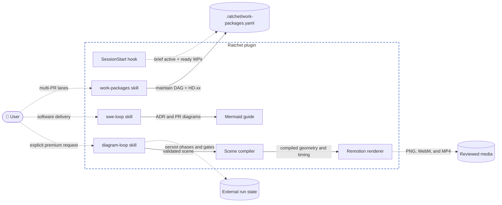

# Ratchet architecture

Ratchet ships one plugin tree to Claude Code and Codex. `swe-loop` governs
software delivery and keeps repository diagrams on the existing Mermaid path.
`work-packages` and the `SessionStart` hook (`hooks/session-start.mjs`) provide
an always-on `.ratchet/` work-package DAG and `Unblock-with` dark-launch ledger
across multi-session and part-time work. `diagram-loop` governs explicitly
requested publication visuals and stores its run state and outputs outside the
target repository.

The premium renderer is private to `diagram-loop`. It does not replace or
automatically run from `swe-loop`. Both paths use fixed, reviewable inputs, but
they have separate dependency locks and output contracts.
