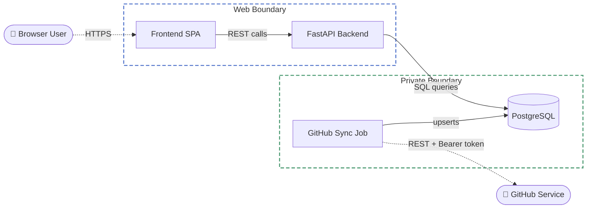
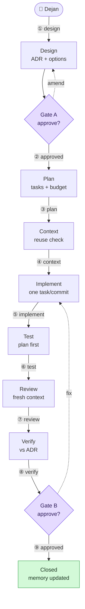

# Mermaid diagram guide

Rules for every diagram produced in this loop (ADRs, architecture overview,
PR descriptions). Grounded in the C4 model notation rules
(https://c4model.com/diagrams/notation, /diagrams/checklist), Microsoft's
architecture-diagram guidance
(https://learn.microsoft.com/en-us/azure/well-architected/architect-role/design-diagrams),
and the mermaid docs (https://mermaid.js.org). Goal: diagrams that
communicate structure at a glance — never five floating boxes with unlabeled
arrows.

## Two archetypes — pick one before drawing anything

- **Structural** — what exists, and how it's grouped (systems, containers,
  trust boundaries). Rules below in "Structural diagrams." This is the only
  archetype ADR 001 covered.
- **Narrative** — what happens, in order, as one process (a request's path
  through a system, a workflow's phases). Rules in "Narrative diagrams."
  Reach for this when the diagram's job is "follow this sequence," not
  "understand this layout" — mixing the two modes in one canvas is exactly
  what rule 1 below forbids.

Both archetypes share the render-QA loop and the GitHub-safe syntax rule
just below; nothing about rendering or shipping differs between them.

## Syntax: GitHub-safe only

- Use **flowchart with `subgraph`** to express C4-style diagrams. Do NOT use
  mermaid's `C4Context`/`C4Container` syntax (officially experimental, poor
  layout, unreliable on GitHub) or `architecture-beta` (its icon packs never
  load on GitHub — only 5 default icons render).
- Target the GitHub-rendered subset: flowchart, sequenceDiagram,
  stateDiagram-v2, erDiagram all render fine
  (https://docs.github.com/en/get-started/writing-on-github/working-with-advanced-formatting/creating-diagrams).

## Structural diagrams

### Rules (all mandatory)

1. **One abstraction level per diagram.** Context (system + users + external
   systems), container (deployable units + tech), or component (inside one
   container) — never mixed. Zooming = a second diagram, not more boxes.
2. **Every element is typed by shape, consistently:**
   - person/actor → stadium with emoji: `User(["👤 Browser User"])`
   - service/app → rectangle, technology in the label: `API["FastAPI Backend"]`
   - datastore → cylinder: `DB[("PostgreSQL")]`
   - external system → stadium + dotted edges into it
   - decision → diamond; queue/topic → `@{ shape: das }` (v11.3+)
3. **Every edge: unidirectional, labeled with intent + protocol.**
   `Frontend -->|"REST calls"| API`, `SyncJob -.->|"REST + Bearer token"| GitHub`.
   Arrow points initiator → dependency. Never bidirectional arrows, never a
   bare arrow, never a vague "uses".
4. **Boundaries are named, styled subgraphs** — trust boundary, deployment
   boundary, or container grouping. Dashed stroke, **never a fill**:
   `style web fill:none,stroke:#5577cc,stroke-width:2px,stroke-dasharray:7 4`
   Hard-coded light fills are a proven failure: GitHub's dark theme renders
   subgraph titles in near-white text, which disappears against a pastel
   fill. Stroke-only boundaries stay legible in both themes.
5. **Line style carries meaning:** solid `-->` = in-boundary/synchronous;
   dotted `-.->` = crossing a boundary, external, or async. Be consistent.
6. **≤ ~10–12 nodes per diagram.** Over that: split by zoom level or by
   scenario — never cram.
7. **Direction:** `LR` for request/data-flow chains (client → api → db);
   `TB` for hierarchies. Reorder node declarations to reduce edge crossings.
8. **Consistency across the repo:** same shape = same meaning in every
   diagram; same classDef/style palette; color is never the only carrier of
   meaning (colorblind/print-safe).
9. **Right type for the right question:** structure → flowchart (C4-style);
   runtime order of ONE scenario → sequenceDiagram (shows sync vs async);
   object lifecycle → stateDiagram; data model → erDiagram. Don't force
   runtime behavior into a structure diagram.
10. **When not to diagram:** code-level structure (IDE/tooling territory per
    c4model.com) and trivial changes. A diagram that restates one sentence
    is noise.

### Canonical example

Adapted from the platform threat model — actors, stroke-only trust
boundaries (theme-safe), protocol-labeled edges, cylinder datastore, dotted
external calls:



## Narrative diagrams

For "what happens, in order" instead of "what exists." Grounded in a
decomposition of ByteByteGo's system-design diagrams (blog.bytebytego.com,
youtube.com/@ByteByteGo) — widely regarded as the clearest public example of
this mode — split into what's pure convention (this section) versus what
requires a render-and-commit image pipeline (icons, sticker fills). Only the
convention half is covered here; everything below renders natively in
GitHub's inline mermaid, no extra tooling. The icon/sticker-fill half is
deliberately separate scope, not addressed in this section.

### Rules (all mandatory)

1. **Number every step on its edge label**, prefixed with a circled digit:
   `A -->|"① check cache"| B`, `B -->|"② cache miss"| C`. This is what lets
   layout zigzag freely — the reader follows the numbers, not the geometry.
   Unicode circled digits (① U+2460 through ⑳ U+2473) render as plain text,
   no icon dependency.
2. **Semantic color has exactly one meaning per hue, fixed across every
   narrative diagram in this repo** — not chosen per-diagram, and never
   applied to a node it doesn't actually describe just for visual variety:

   | Class | Meaning | classDef |
   |---|---|---|
   | `success` | completed / cache-hit | `fill:#d3f9d8,stroke:#2f9e44,color:#1a3620` |
   | `transport` | data in transit / network call | `fill:#d0ebff,stroke:#1971c2,color:#0b3866` |
   | `protocol` | an in-flight message worth naming (header, status code) | `fill:#fff3bf,stroke:#e8a400,color:#5c4500` |
   | `blocked` | error / miss / failure path | `fill:#ffe3e3,stroke:#e03131,color:#5c1a1a` |
   | `decision` | a gate or data-at-rest point | `fill:#e5dbff,stroke:#7048e8,color:#2c1a5c` |

   All five `classDef`s set fill+stroke+explicit text color, so contrast
   holds in both GitHub themes without per-theme images. Apply with
   `class NodeName success`. A diagram whose domain has no network calls or
   protocol messages simply doesn't use those two classes — leaving a class
   unused is correct; misapplying one to a node it doesn't describe, purely
   for variety, is the one thing this rule forbids.
3. **Micro-copy: 1-3 words per node label.** Explanatory sentences belong in
   the surrounding prose, never the canvas. Target the whole diagram under
   roughly 100-120 words total (labels + edge annotations combined) — past
   that, it is two diagrams pretending to be one; split it.
4. Everything else — direction, node-count ceiling, edge-crossing
   discipline, the render-QA loop, the self-check — is unchanged from the
   structural rules above. A narrative diagram is a flowchart with these
   four additional conventions layered on, not a different syntax.

### Canonical example

The swe-loop workflow's own 8 phases and 2 gates, as a narrative diagram —
numbered edges (rule 1), micro-copy (rule 3), and only the palette classes
this domain actually has: `decision` for the two gates (reinforcing the
diamond shape already required by the structural rules — shape and color
agree, never conflict) and `success` for the terminal close. Nothing here
is a network call or an in-flight protocol message, so `transport` and
`protocol` are correctly unused, not forced in for variety:



Passed render QA (dark + light, mermaid-cli) before shipping: node text
stays legible in both themes because color is set explicitly per class
rather than left to theme defaults — the same lesson ADR 001 learned about
subgraph titles applies to node fills, with the fix being the opposite move
(declare the color, don't omit it). Unclassed nodes (the six regular phase
steps) use mermaid's own theme-adaptive default styling and need no
explicit color at all — confirmed legible in both renders.

## Render QA — mandatory for every new or changed diagram

Never ship a diagram you have only read as source. Render it, look at the
pixels, fix what you see, re-render — the same discipline Playwright QA
applies to frontends. Syntax that parses can still render illegibly (title
washout, label-on-node overlap, clipped text at canvas edges, long crossing
edges), and none of that is visible in the source text.

```bash
npx -y @mermaid-js/mermaid-cli -i d.mmd -o d-dark.png  -t dark -b '#0d1117'
npx -y @mermaid-js/mermaid-cli -i d.mmd -o d-light.png -b white
```

(First run downloads a headless browser; cached afterward, renders take
seconds.)

Inspect BOTH images and check:

1. Every subgraph title and edge label legible in the dark render — title
   washout on dark is the most common failure.
2. No edge label sitting on top of a node; no text clipped at a canvas edge.
3. Edges traceable: no long crossings, no edge whose origin box is
   ambiguous. Reorder node/subgraph declarations to fix routing.
4. The actor/initiator sits where the flow starts reading (left in LR, top
   in TB), not floating at the far edge.

Fix, re-render, repeat until every point passes; then run the self-check
below on the final render. GitHub's exact theme differs slightly from
mermaid-cli's, but every failure listed above reproduces in both.

## Self-check before shipping a diagram

The C4 review checklist, condensed: does it have a clear scope? Is every
element named with purpose (and technology) clear? Is every line labeled with
intent, direction matching the label? Is the meaning of every shape, color,
and line style unambiguous? Would a reader who wasn't in this session
understand it cold?
